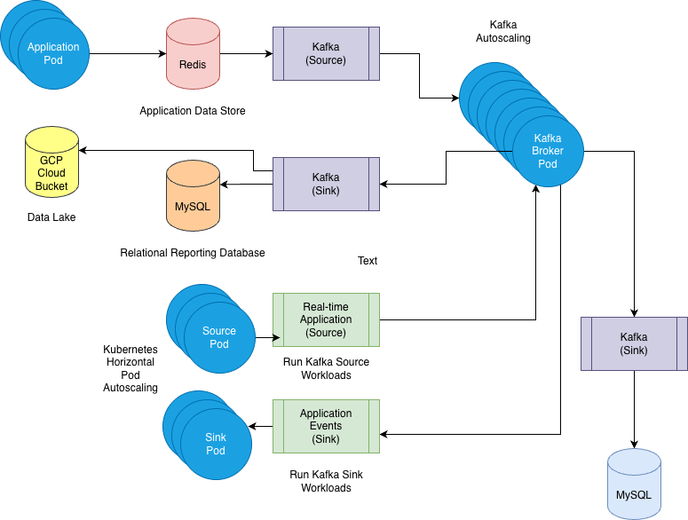

# CSAI 380: AI Operations — Block Project (STEDI)

Over the course you build one project in stages: you deploy the [STEDI](https://github.com/STEDI-Balance/stedi-web) balance-device application to your own GKE Autopilot cluster, then add persistent storage, a batch ETL pipeline, event streaming with Kafka, and a scaled downstream integration. Each week's N.5 Block Project builds on the previous one, so complete them in order.

Each student works in their own Vocareum-provided GCP project and uses the GKE Autopilot cluster they created in [1.4 Build, Deploy, and Explore](https://github.com/Ensign-College/CSAI380Content/blob/main/1.4-build-deploy-explore.md) (region `us-east1`).

## Table of Contents

| Week | Assignment | What you build | Status |
| ---- | ---------- | -------------- | ------ |
| 1 | [1.5 Block Project: Collecting the Data](1.5-collecting-the-data.md) | Containerize and deploy STEDI to GKE, Terraform namespace/registry, GitHub Actions build/push, architecture v1 | ✅ VERIFIED 2026-10-30 |
| 2 | [2.5 Block Project: Saving the Data](2.5-saving-the-data.md) | Redis and MySQL StatefulSets, headless services, secrets via secretKeyRef, persistence experiment | ✅ VERIFIED 2026-10-30 |
| 3 | [3.5 Block Project: Working ETL Pipeline](3.5-working-etl-pipeline.md) | Airflow ETL DAG, pandas transform, idempotent load into MySQL, troubleshooting loop | 🚧 DRAFT |
| 4 | [4.5 Block Project: Streaming or Micro-batches](4.5-streaming-or-micro-batches.md) | Kafka via Helm, `customer-risk` topic, producer/consumer round trip, processing models | ✅ VERIFIED 2026-10-30 |
| 5 | [5.5 Block Project: Scaling and Downstream Integration](5.5-scaling-and-downstream-integration.md) | Consumer lag, scaling experiment, idempotent upsert, analytical SQL, final architecture | 🚧 DRAFT |

Each assignment's status banner sits directly under its title. ✅ VERIFIED means every step was run against a real GKE/GCP environment; 🚧 DRAFT means the instructions may still change.

## Starter files

The files the assignments tell you to use, copy, or complete are in [starter/](starter/):

| Folder | Contents | First used |
| ------ | -------- | ---------- |
| [starter/terraform/](starter/terraform/) | Namespace and Artifact Registry repository (later a GCS bucket) | 1.5 |
| [starter/.github/workflows/](starter/.github/workflows/) | GitHub Actions workflow that builds, pushes, and deploys STEDI | 1.5 |
| [starter/k8s/stedi/](starter/k8s/stedi/) | STEDI Deployment and Service | 1.5 |
| [starter/k8s/stateful/](starter/k8s/stateful/) | Redis and MySQL StatefulSets, services, and secret example | 2.5 |
| [starter/dags/](starter/dags/), [starter/data/](starter/data/), [starter/helm/airflow-values.yaml](starter/helm/airflow-values.yaml) | Airflow ETL DAG, sample CSV, and Airflow Helm values | 3.5 |
| [starter/helm/kafka-values.yaml](starter/helm/kafka-values.yaml), [starter/k8s/kafka/](starter/k8s/kafka/) | Kafka Helm values, client and consumer pods, STEDI Kafka patch | 4.5 |
| [starter/app/](starter/app/) | MySQL sink consumer | 5.5 |

Values you must replace are written as `<angle-brackets>`, and code you must write is marked `# TODO(student):`.

## Related

- Weekly Skill Practice assignments (N.4) and their starter repos: [CSAI380Content](https://github.com/Ensign-College/CSAI380Content)
- STEDI application source: [STEDI-Balance/stedi-web](https://github.com/STEDI-Balance/stedi-web)
- Rules for anyone (person or AI agent) editing this repository: [AGENTS.md](AGENTS.md)
