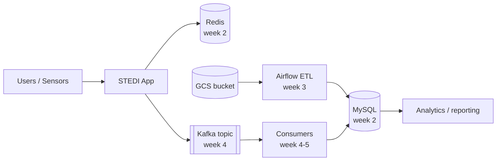

# 1.5 Collecting the Data — Teacher Notes

> Exercise status: 🚧 DRAFT — step 5.2 changed 2026-10-29 (reuse the 1.4 key, add `roles/container.developer`); needs a live Actions run. Previously: ✅ VERIFIED 2026-10-29 against a GKE Autopilot cluster (us-central1) in an instructor test project (namespace verify15-stedi), STEDI from the STEDI-Balance/stedi-web ZIP, registry and bucket in us-east1. Previously verified 2026-10-15 (namespace verify-stedi).

## Solutions

### Terraform TODO — `stedi-dev-sa` service account

Completed resource (see [main.tf](main.tf) in this directory for the full file):

```hcl
resource "kubernetes_service_account" "stedi_dev_sa" {
  metadata {
    name      = "stedi-dev-sa"
    namespace = kubernetes_namespace.student.metadata[0].name
  }
}
```

### Workflow TODO — deploy the built image

Replace the `Deploy manifests` step's run block with:

```yaml
- name: Deploy manifests
  run: |
    kubectl apply -n ${{ env.STUDENT_NAMESPACE }} -f k8s/stedi/
    kubectl set image deployment/stedi -n ${{ env.STUDENT_NAMESPACE }} \
      stedi=${{ env.REGION }}-docker.pkg.dev/${{ secrets.GCP_PROJECT_ID }}/${{ env.STUDENT_NAMESPACE }}-images/${{ env.IMAGE_NAME }}:${{ github.sha }}
    kubectl rollout status deployment/stedi -n ${{ env.STUDENT_NAMESPACE }}
```

### Secrets (step 5.2)

Changed 2026-10-29: students reuse the `github-actions` service account and key from 1.4 Part Five and grant it deploy rights:

```bash
PROJECT_ID=$(gcloud config get-value project)
SA=github-actions@$PROJECT_ID.iam.gserviceaccount.com
gcloud projects add-iam-policy-binding $PROJECT_ID \
  --member="serviceAccount:$SA" --role=roles/container.developer --condition=None
gh secret set GCP_SA_KEY < ~/.csai380/github-actions-key.json
gh secret set GCP_PROJECT_ID --body "$PROJECT_ID"
gh secret set GKE_CLUSTER --body "<cluster-name>"
gh secret set GKE_REGION --body "us-east1"
```

### Command sequence

```bash
cd terraform
terraform init
terraform plan
terraform apply            # outputs: namespace, artifact_registry_repo, etl_bucket
gcloud auth configure-docker us-east1-docker.pkg.dev
# push to main; the workflow builds and deploys
kubectl get pods -n <your-namespace>
kubectl describe deployment stedi -n <your-namespace>
kubectl logs deployment/stedi -n <your-namespace>
```

### Example Architecture v1 Mermaid diagram



## Gotchas

- **Deploy step fails with `Forbidden` / `container.deployments.get` (step 5.2).** The service account has only `roles/artifactregistry.writer` from 1.4; the build and push succeed, then `kubectl apply` is denied. Fix: grant `roles/container.developer` as in step 5.2.
- **`get-gke-credentials` can't find the cluster.** `GKE_CLUSTER`/`GKE_REGION` secrets don't match the cluster from 1.4 (check `gcloud container clusters list`).

- **Apple Silicon images crash on amd64 nodes.** Symptom: pod in `CrashLoopBackOff` with `exec format error` in logs. Fix: the workflow already passes `--platform linux/amd64`; students building locally must do the same.
- **`terraform apply` fails on the kubernetes provider.** Symptom: `connection refused` to localhost:80. Fix: run `gcloud container clusters get-credentials <cluster> --region <region>` first so `~/.kube/config` exists.
- **Artifact Registry push denied.** Symptom: `denied: Permission "artifactregistry.repositories.uploadArtifacts" denied`. Fix: `gcloud auth configure-docker us-east1-docker.pkg.dev` and confirm the CI service account has `roles/artifactregistry.writer`.
- **Liveness probe kills the pod before the JVM boots.** Symptom: restarts every few seconds with no error. Fix: raise `initialDelaySeconds` (10 is usually enough; slow spot nodes may need 20–30).
- **GCE quota scale-up failures.** Symptom: pods stuck `Pending`, event says `scale.up.error.quota.exceeded`. Fix: trim resource requests or wait for capacity; do not raise replicas this week.
- **Terraform ADC expired (verified 2026-10-15).** Symptom: `oauth2: "invalid_grant" "Bad Request"` on apply even though `gcloud` works. Fix: `gcloud auth application-default login` — and check EVERY consent box; unchecking Google Cloud Platform crashes gcloud with `Scope has changed`. Workaround when the browser flow misbehaves: `export GOOGLE_OAUTH_ACCESS_TOKEN=$(gcloud auth print-access-token)` before terraform commands.
- **Week-1 deployment referenced the week-2 redis secret (fixed during verification).** The starter deployment now sets `optional: true` on the `redis-secrets` secretKeyRef so the pod starts before week 2; without it the pod sits in `CreateContainerConfigError`.
- **First `kubectl apply` leaves a pod stuck on `:latest` (seen 2026-10-29).** The starter manifest references `stedi:latest`, but the workflow pushes only the commit-SHA tag, so the first ReplicaSet can't pull its image until `kubectl set image` replaces it. Harmless: the rollout finishes once the SHA-tagged pod is ready.
- **Starter `.gitignore` replaces stedi-web's (seen 2026-10-29).** Copying [starter/.gitignore](../../starter/.gitignore) over stedi-web's drops its `/target/` and IDE entries, so local Maven builds show up as untracked files. Students can merge the two files.
- **`terraform.tfvars` is not ignored (seen 2026-10-29).** The starter `.gitignore` doesn't list it, so students commit their project ID. Not a secret, but inconsistent with 1.4's starter.
