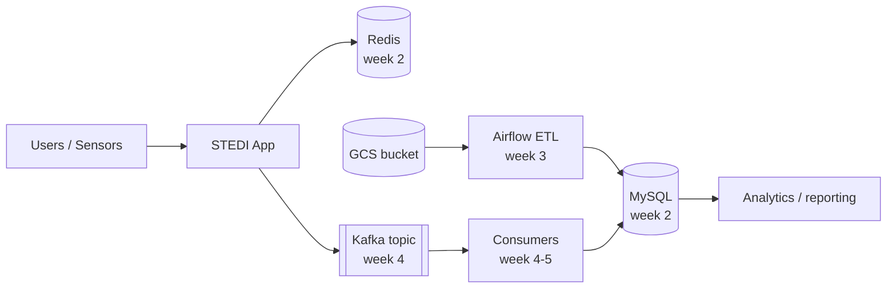

# 1.5 Collecting the Data — Teacher Notes

> Exercise status: 🚧 DRAFT — gotchas below are preliminary and will be expanded during verification testing.

## Solutions

### Terraform TODO — `stedi-dev-sa` service account

Completed resource (see [main.tf](main.tf) in this directory for the full file):

```hcl
resource "kubernetes_service_account" "stedi_dev_sa" {
  metadata {
    name      = "stedi-dev-sa"
    namespace = kubernetes_namespace.student.metadata[0].name
  }
}
```

### Workflow TODO — deploy the built image

Replace the `Deploy manifests` step's run block with:

```yaml
- name: Deploy manifests
  run: |
    kubectl apply -n ${{ env.STUDENT_NAMESPACE }} -f k8s/stedi/
    kubectl set image deployment/stedi -n ${{ env.STUDENT_NAMESPACE }} \
      stedi=${{ env.REGION }}-docker.pkg.dev/${{ secrets.GCP_PROJECT_ID }}/${{ env.STUDENT_NAMESPACE }}-images/${{ env.IMAGE_NAME }}:${{ github.sha }}
    kubectl rollout status deployment/stedi -n ${{ env.STUDENT_NAMESPACE }}
```

### Command sequence

```bash
cd terraform
terraform init
terraform plan
terraform apply            # outputs: namespace, artifact_registry_repo, etl_bucket
gcloud auth configure-docker us-central1-docker.pkg.dev
# push to main; the workflow builds and deploys
kubectl get pods -n <your-namespace>
kubectl describe deployment stedi -n <your-namespace>
kubectl logs deployment/stedi -n <your-namespace>
```

### Example Architecture v1 Mermaid diagram



## Gotchas

- **Apple Silicon images crash on amd64 nodes.** Symptom: pod in `CrashLoopBackOff` with `exec format error` in logs. Fix: the workflow already passes `--platform linux/amd64`; students building locally must do the same.
- **`terraform apply` fails on the kubernetes provider.** Symptom: `connection refused` to localhost:80. Fix: run `gcloud container clusters get-credentials <cluster> --region <region>` first so `~/.kube/config` exists.
- **Artifact Registry push denied.** Symptom: `denied: Permission "artifactregistry.repositories.uploadArtifacts" denied`. Fix: `gcloud auth configure-docker us-central1-docker.pkg.dev` and confirm the CI service account has `roles/artifactregistry.writer`.
- **Liveness probe kills the pod before the JVM boots.** Symptom: restarts every few seconds with no error. Fix: raise `initialDelaySeconds` (10 is usually enough; slow spot nodes may need 20–30).
- **GCE quota scale-up failures.** Symptom: pods stuck `Pending`, event says `scale.up.error.quota.exceeded`. Fix: trim resource requests or wait for shared-cluster capacity; do not raise replicas this week.
